
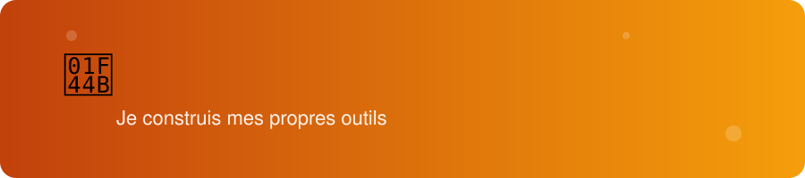

Développeur passionné, je construis mes propres outils : une application web pour la famille, un bot de trading et une maison connectée.

## Projets

### Work in Progress

**Rifaiuolo** — Application web familiale complète, utilisée au quotidien par plusieurs foyers (mobile et desktop)
- Next.js 16, React 19, Tailwind 4, Supabase (sécurité RLS par foyer)
- Auto-hébergée sur un VPS OVH (systemd + Nginx), déploiement scripté
- Plus de 100 jeux (solo, duo, temps réel), avec défis quotidiens
- Modules bébé, cycle, courses, maison, véhicule, wishlist, chat de foyer…
- Notifications push, mode hors ligne (PWA)
- ~1 900 commits et ~1 700 PR en 4 mois

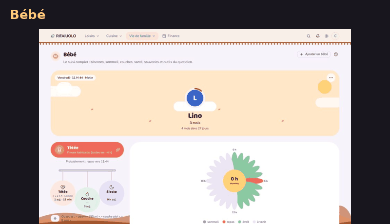

*Aperçus (données fictives) :*

| Bébé | La Cave | Ludothèque |
|---|---|---|
| 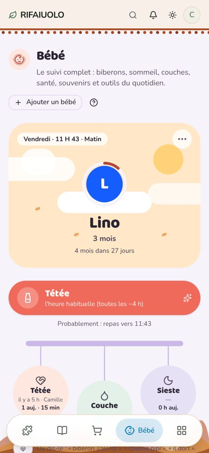 | 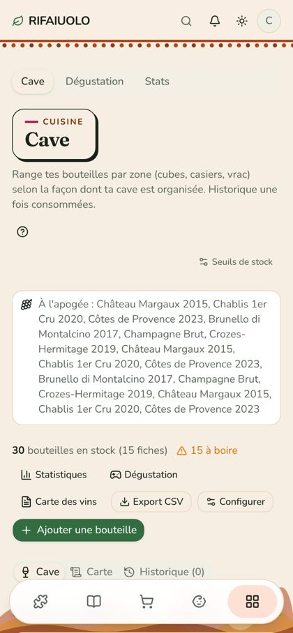 | 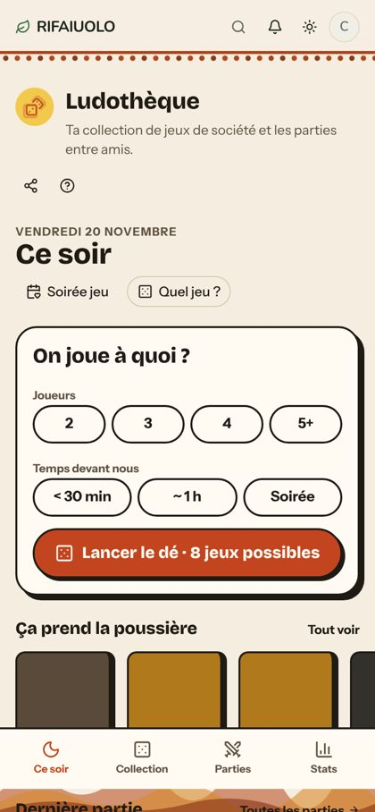 |

Voir aussi la version desktop

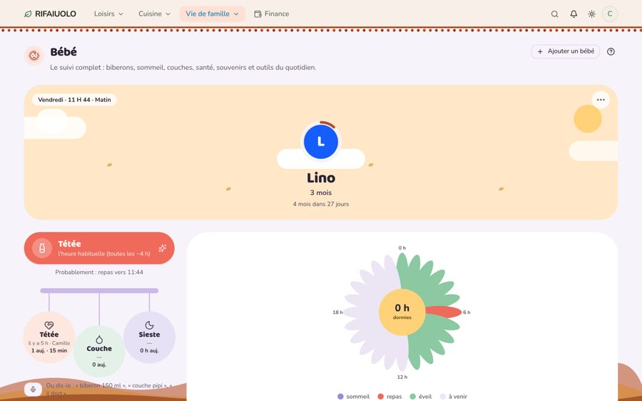 
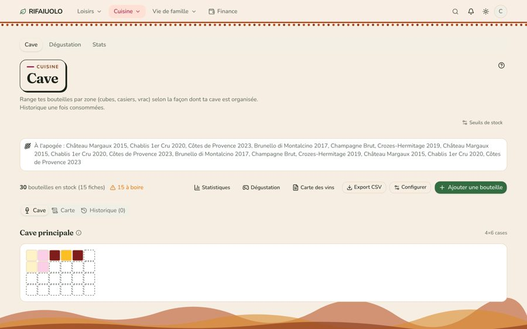 
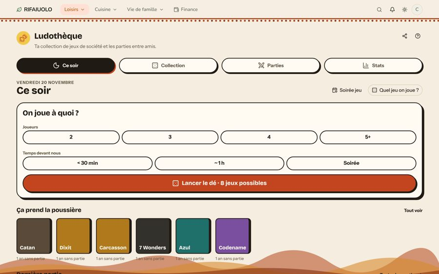

**Les arcades de Rifaiuolo** — Jeux 2D et 3D faits maison, jouables au téléphone comme au PC
- Mini-golf (éditeur de parcours, moulins, rampes), Orbite (fronde et gravité), Rebond Néon (thèmes, boss, duel), Lueurs, Ricochet Laser (niveaux + éditeur)

| Mini-golf | Orbite | Rebond Néon |
|---|---|---|
| 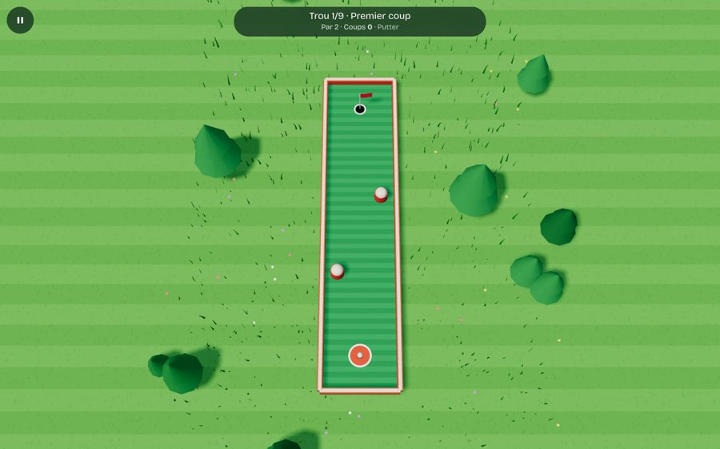 | 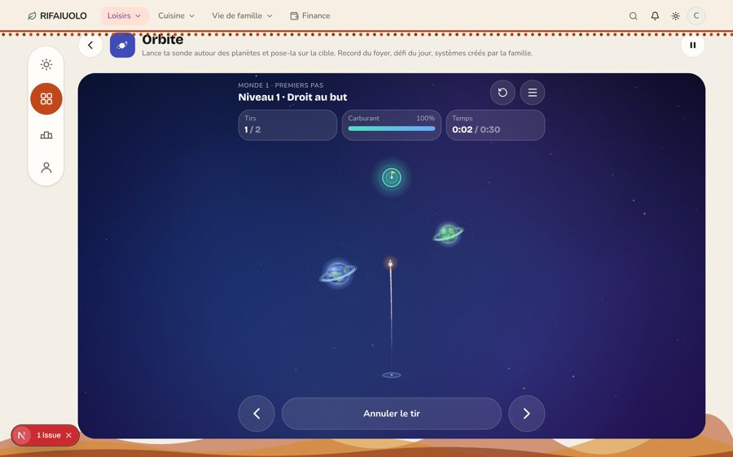 | 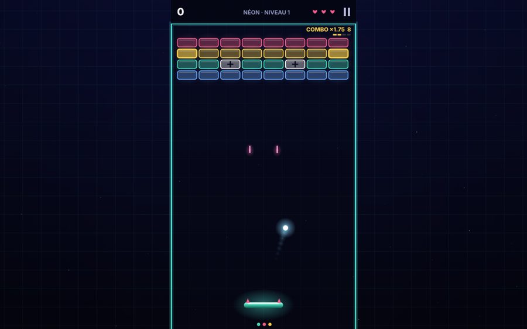 |

| Lueurs | Ricochet Laser |
|---|---|
| 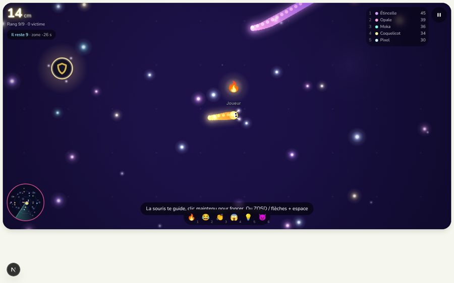 | 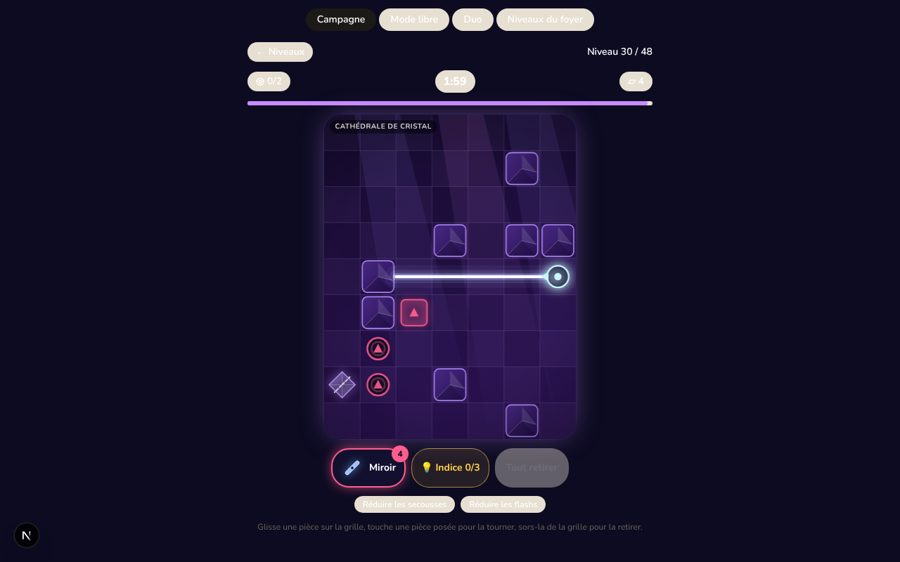 |

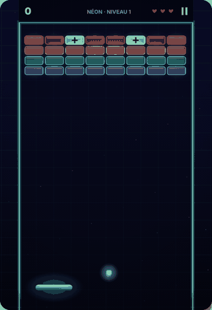

**My Trading Bot** — Bot de trading crypto en TypeScript pour Hyperliquid
- Stratégies extensibles (momentum, grille, carry delta-neutre)
- Gestion du risque : stop loss, limite de perte quotidienne, kill switch
- Backtesting et walk-forward pour éviter le sur-ajustement
- Alertes et commandes via Telegram, PostgreSQL, Docker

**Maison connectée** — Home Assistant sur mesure
- HAOS, lumières Hue, Alexa, aspirateur Ecovacs, voiture électrique
- Tableau de bord responsive avec vue 3D de l'appartement
- Notifications avec heures de silence

### Completed

**Claude Memory** — Mémoire de développement du projet Rifaiuolo
- Notes de décisions, brainstorms et backlog, mises à jour au fil de l'eau

---

*Ces repos sont privés, mais je peux en montrer des extraits ou une démo sur demande.*
